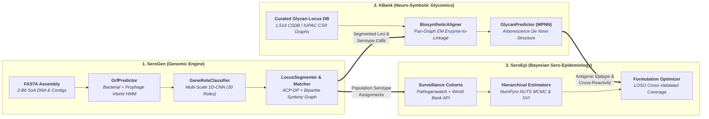

<div class="sv-hero" markdown>

<div class="sv-hero-eyebrow" markdown="span">:lucide-orbit: The SeroVerse Computational Suite</div>

# From Genome Assemblies to Glycan Structures & Vaccine Formulations

**SeroVerse** is an end-to-end, high-performance Python ecosystem uniting **bacterial polysaccharide locus genomics (`SeroGen`)**, **neuro-symbolic glycomics and biosynthetic pathway alignment (`KBank`)**, and **hierarchical Bayesian sero-epidemiological modelling (`SeroEpi`)**.

<div class="sv-badges">
  
  
  
  
  
</div>

<div class="sv-hero-actions" markdown>
  <a href="#the-three-pillars" class="sv-btn sv-btn--primary" markdown="span">:lucide-layers: Explore the Ecosystem</a>
  <a href="https://tomdstanton-seroepi.share.connect.posit.cloud" target="_blank" rel="noopener" class="sv-btn sv-btn--secondary" markdown="span">:lucide-app-window: Launch SeroEpi Live App ↗</a>
  <a href="https://github.com/SeroVerse" target="_blank" rel="noopener" class="sv-btn sv-btn--secondary" markdown="span">:fontawesome-brands-github: GitHub Organization ↗</a>
</div>

<div class="sv-stat-strip">
  <div class="sv-stat-item">
    <span class="sv-stat-value">&gt;65 Mb/s</span>
    <span class="sv-stat-label">Single-pass bacterial + prophage ORF calling (~70 ms per genome)</span>
  </div>
  <div class="sv-stat-item">
    <span class="sv-stat-value">1,514</span>
    <span class="sv-stat-label">Curated bacterial glycan graphs paired with biosynthetic gene clusters</span>
  </div>
  <div class="sv-stat-item">
    <span class="sv-stat-value">91.4% F1</span>
    <span class="sv-stat-label">Zero-dependency 1D-CNN protein role classification across 30 roles</span>
  </div>
  <div class="sv-stat-item">
    <span class="sv-stat-value">MCMC &amp; SVI</span>
    <span class="sv-stat-label">Hierarchical Bayesian prevalence &amp; LOSO-validated vaccine design</span>
  </div>
</div>

</div>

---

## The Three Pillars { #the-three-pillars }

Select a pillar below to explore its documentation, interactive benchmark slide decks, API references, and live applications.

<div class="sv-pillar-grid">

  <article class="sv-pillar-card sv-pillar-card--serogen">
    <div>
      <div class="sv-pillar-header">
        <h3 class="sv-pillar-title" markdown="span">:lucide-dna: SeroGen</h3>
        <span class="sv-pillar-badge">1 · Genomics</span>
      </div>
      <p class="sv-pillar-desc">
        Zero-copy Structure-of-Arrays (SoA) genomic engine that decodes bacterial and prophage ORFs, classifies biosynthetic protein roles via a pure NumPy/Numba 1D-CNN, segments capsule and O-antigen loci via exact ACP-DP, and resolves serotypes with bipartite graph alignment.
      </p>
      <div class="sv-pillar-metrics">
        <span class="sv-metric-pill">Zero CLI Dependencies</span>
        <span class="sv-metric-pill">99.7% 3'-Stop Recall</span>
        <span class="sv-metric-pill">100% Contig-Split Stitching</span>
      </div>
    </div>
    <div class="sv-pillar-links">
      <a href="https://seroverse.github.io/SeroGen/" class="sv-pillar-link">Docs &amp; Guide</a>
      <a href="https://seroverse.github.io/SeroGen/notebooks/" class="sv-pillar-link sv-pillar-link--ghost">Marimo Slides</a>
      <a href="https://seroverse.github.io/SeroGen/reference/" class="sv-pillar-link sv-pillar-link--ghost">API</a>
      <a href="https://github.com/SeroVerse/SeroGen" target="_blank" rel="noopener" class="sv-pillar-link sv-pillar-link--ghost">GitHub ↗</a>
    </div>
  </article>

  <article class="sv-pillar-card sv-pillar-card--kbank">
    <div>
      <div class="sv-pillar-header">
        <h3 class="sv-pillar-title" markdown="span">:lucide-hexagon: KBank</h3>
        <span class="sv-pillar-badge">2 · Glycomics</span>
      </div>
      <p class="sv-pillar-desc">
        Geno-glycomic database and neuro-symbolic structure predictor bridging <code>SeroGen</code> gene clusters to directed chemical polysaccharide graphs (<code>CSDB</code> / <code>IUPAC</code> / RDKit <code>Mol</code>) via bipartite enzyme-to-linkage alignment and a Relational Message-Passing Neural Network.
      </p>
      <div class="sv-pillar-metrics">
        <span class="sv-metric-pill">1,514 Locus–Glycan Pairs</span>
        <span class="sv-metric-pill">&gt;92% Monosaccharide F1</span>
        <span class="sv-metric-pill">Bipartite GT-Linkage EM</span>
      </div>
    </div>
    <div class="sv-pillar-links">
      <a href="https://seroverse.github.io/KBank/" class="sv-pillar-link">Docs &amp; Guide</a>
      <a href="https://seroverse.github.io/KBank/notebooks/" class="sv-pillar-link sv-pillar-link--ghost">Benchmarks</a>
      <a href="https://seroverse.github.io/KBank/reference/" class="sv-pillar-link sv-pillar-link--ghost">API</a>
      <a href="https://github.com/SeroVerse/KBank" target="_blank" rel="noopener" class="sv-pillar-link sv-pillar-link--ghost">GitHub ↗</a>
    </div>
  </article>

  <article class="sv-pillar-card sv-pillar-card--seroepi">
    <div>
      <div class="sv-pillar-header">
        <h3 class="sv-pillar-title" markdown="span">:lucide-chart-network: SeroEpi</h3>
        <span class="sv-pillar-badge">3 · Epidemiology</span>
      </div>
      <p class="sv-pillar-desc">
        <code>scikit-learn</code> and <code>JAX</code>/<code>NumPyro</code> library for genomic sero-epidemiology. Ingests Pathogenwatch cohorts and UN/World Bank demographics, fits stratified hierarchical Bayesian prevalence models, and optimizes multi-valent vaccine and phage formulations.
      </p>
      <div class="sv-pillar-metrics">
        <span class="sv-metric-pill">NUTS MCMC &amp; SVI</span>
        <span class="sv-metric-pill">LOSO Formulation CV</span>
        <span class="sv-metric-pill">PyShiny Web Dashboard</span>
      </div>
    </div>
    <div class="sv-pillar-links">
      <a href="https://seroverse.github.io/SeroEpi/" class="sv-pillar-link">Docs &amp; Guide</a>
      <a href="https://tomdstanton-seroepi.share.connect.posit.cloud" target="_blank" rel="noopener" class="sv-pillar-link sv-pillar-link--ghost">Live Web App ↗</a>
      <a href="https://seroverse.github.io/SeroEpi/app/" class="sv-pillar-link sv-pillar-link--ghost">Embedded App</a>
      <a href="https://github.com/SeroVerse/SeroEpi" target="_blank" rel="noopener" class="sv-pillar-link sv-pillar-link--ghost">GitHub ↗</a>
    </div>
  </article>

</div>

---

## End-to-End Architecture

**SeroVerse** connects raw sequencing reads and assemblies directly to structural glycobiology and public-health intervention design:



---

## Technical Highlights Across the Suite

<div class="grid cards" markdown>

-   :lucide-zap: **Zero-Copy SoA & SIMD Acceleration (`SeroGen`)**

    ---

    Contigs, intervals, k-mer randstrobes, and CSR graphs are stored in contiguous NumPy Structure-of-Arrays buffers (`serogen.core`) operated on by GIL-free Numba kernels — eliminating external binary wrappers (`prodigal`, `diamond`, `minimap2`, `blast+`).

-   :lucide-cpu: **Single-Pass Prophage & Bacterial Gene Calling (`SeroGen`)**

    ---

    `OrfPredictor` combines a 21-state frameshift-tolerant profile-HMM with Shine-Dalgarno RBS scoring and viral gap rescue, achieving **99.7% 3'-stop recall** on bacterial chromosomes and **95.3% recall** across embedded prophages at **>65 Mb/s**.

-   :lucide-git-fork: **Neuro-Symbolic Glycan Biosynthesis (`KBank`)**

    ---

    `KBank` pairs factorized 1D-CNN glycosyltransferase/polymerase classifiers (`BiosyntheticClassifierSuite`) with a 2-layer Relational MPNN and a branch-and-bound Constrained Spanning Arborescence solver (`GlycanPredictor`) to reconstruct complete repeating-unit topologies *de novo*.

-   :lucide-network: **Bipartite Gene-to-Glycan Alignment (`KBank`)**

    ---

    `BiosyntheticAligner` maps individual glycosyltransferases, acetyltransferases, and `Wzy`/`Wzx` flippases onto specific monosaccharide linkages using pan-graph Expectation-Maximization homology priors and biological Und-PP reducing-end frame rotation.

-   :lucide-chart-bar-stacked: **Hierarchical Partial Pooling (`SeroEpi`)**

    ---

    `SeroEpi` models geographic, temporal, and clinical sampling heterogeneity using `JAX`/`NumPyro` Binomial and Beta-Binomial hierarchical estimators (`MCMC` NUTS and `SVI`), preventing small-stratum noise from distorting global antigen rankings.

-   :lucide-shield-check: **LOSO-Validated Vaccine Formulation (`SeroEpi`)**

    ---

    The `Formulation` meta-estimator selects optimal $K$-valent capsule/O-antigen cocktails under pooled or equal-stratum weights, controls Bayesian/BH False Discovery Rates against burden thresholds, and quantifies geographic generalizability via Leave-One-Stratum-Out CV.

</div>

---

## Unified Quickstart

=== "1. SeroGen — De Novo Locus & Serotype Calling"

    ```python
    from serogen import GenomeAssembly, LocusDatabase, LocusMatcher, LocusPredictor

    # 1. Load a bacterial genome assembly (single or fragmented multi-contig FASTA)
    assembly = GenomeAssembly.from_fasta("klebsiella_isolate.fasta")

    # 2. Predict ORFs (bacterial + prophage), classify 30 CNN gene roles, and segment loci via ACP-DP
    predictor = LocusPredictor()
    loci = predictor.predict(assembly)

    for locus in loci:
        print(f"{locus.archetype.name}: {locus.start}..{locus.end} ({len(locus.genes)} genes)")

    # 3. Match segmented loci against a compiled reference database with bipartite synteny alignment
    db = LocusDatabase.load("spneumo_cps.npz")
    matcher = LocusMatcher.from_database(db)
    best = matcher.match(loci)[0]
    print(f"Serotype: {best.serotype} (score={best.score:.3f}, AA identity={best.mean_aa_identity:.1%})")
    ```

=== "2. KBank — Neuro-Symbolic Glycan Prediction"

    ```python
    from kbank import BiosyntheticAligner, GlycanPredictor, IUPACParser
    from kbank.db import Records
    from serogen import GenomeAssembly, LocusPredictor

    # 1. Load the 1,514 curated bacterial glycan + biosynthetic gene cluster records
    records = Records.load()

    # 2. Segment a capsular polysaccharide locus from raw assembly DNA via SeroGen
    assembly = GenomeAssembly.from_fasta("KL106.fasta")
    locus = LocusPredictor().predict(assembly)[0]

    # 3. Predict the complete repeating-unit polysaccharide structure de novo via Relational MPNN
    predictor = GlycanPredictor.from_records(records)
    top_hit = predictor.predict(locus, top_k=1)[0]
    print(f"Predicted CSDB structure: {top_hit.glycan.to_csdb().decode()} (p={top_hit.probability:.2%})")

    # 4. Or align a locus directly to a known IUPAC/CSDB glycan to assign enzyme-to-linkage roles
    aligner = BiosyntheticAligner.from_records(records)
    assignment = aligner.align(locus, top_hit.glycan)
    ```

=== "3. SeroEpi — Bayesian Prevalence & Vaccine Design"

    ```python
    from seroepi.aggregate import Aggregator
    from seroepi.estimators.formulation import FormulationEstimator
    from seroepi.estimators.hierarchical import HierarchicalSVIEstimator
    from seroepi.examples import KlebnetNeonatalSepsis
    from seroepi.plotting.choropleth import ChoroplethPlotter

    # 1. Load the KlebNET Neonatal Sepsis surveillance cohort (981 K. pneumoniae isolates)
    ds = KlebnetNeonatalSepsis.load_built()

    # 2. Aggregate K-locus serotype counts stratified by country/site
    agg = Aggregator(target=ds.var("K_locus"), strata=[ds.var("country")]).fit(ds)

    # 3. Fit a NumPyro Hierarchical Bayesian estimator & 10-valent vaccine formulation
    est = HierarchicalSVIEstimator().fit(agg)
    vaccine = FormulationEstimator(max_valency=10).fit(est)
    chart = ChoroplethPlotter().plot(est)
    ```

---

## Interactive Benchmarks & Live Applications

| Pillar | Interactive Resource | Highlights |
| :--- | :--- | :--- |
| **SeroGen** | [Prophage & Bacterial ORF Benchmark](https://seroverse.github.io/SeroGen/notebooks/prophage-orfs/) | Interactive 16:9 Marimo slide deck benchmarking `OrfPredictor` across complete *K. pneumoniae* chromosomes (**99.7% 3'-stop recall**) and prophages (**95.3% recall**). |
| **SeroGen** | [Multi-Scale 1D-CNN Role Classifier](https://seroverse.github.io/SeroGen/notebooks/gene-classifier/) | Optuna TPE hyperparameter tuning and confusion matrices across 30 polysaccharide biosynthesis, transport, and MGE roles (**91.4% Macro F1**). |
| **SeroGen** | [*S. pneumoniae* 98-Serotype CPS Benchmark](https://seroverse.github.io/SeroGen/notebooks/spneumo-serotyping/) | Whole-genome serotyping (**100% Top-1 accuracy**), contig-split boundary stitching, LOO novelty detection, and Fruchterman-Reingold synteny networks. |
| **KBank** | [CSDB Curation & BGC-to-Glycan Alignment](https://seroverse.github.io/KBank/notebooks/) | Curation of **1,514** bacterial surface polysaccharide structures, pan-graph EM glycosyltransferase assignment, and MPNN *de novo* structure recovery (`KL106`, `KL107`). |
| **SeroEpi** | [Live PyShiny Surveillance & Formulation App ↗](https://tomdstanton-seroepi.share.connect.posit.cloud) | Interactive cohort explorer, compositional antigen target builder, NUTS MCMC / SVI Bayesian prevalence fitting, spatial choropleths, UpSet plots, and vaccine coverage curves. |

---

## Installation

Each pillar package can be installed independently or together via [`uv`](https://docs.astral.sh/uv/) or `pip`:

```bash
# Core genomic ORF calling, 1D-CNN role classification, and locus segmentation
uv add serogen

# Geno-glycomic database, CSDB/IUPAC graph parsers, and MPNN glycan predictor
uv add kbank

# Bayesian sero-epidemiological estimators, plotting, and interactive PyShiny dashboard
uv add "seroepi[all]"
```
